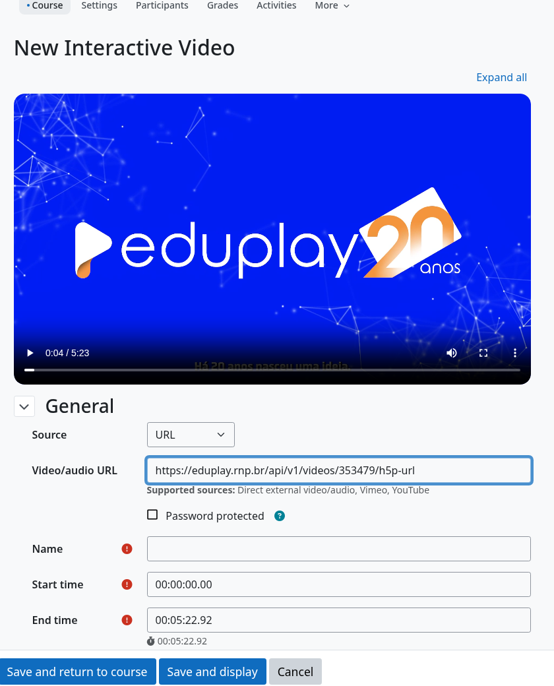

moodle-local_eduplay
====================

.. PITCH-BEGIN (generated by workspace/docs/tools/pitch_docs.py; edit there)

**Use qualquer vídeo do EduPlay no Moodle sem enviar nem copiar o arquivo.**

   Colando um link do EduPlay no formulário do Interactive Video: ele vira o endereço reproduzível e o vídeo carrega.

* **Cole o link normal da página.** Copie ``https://eduplay.rnp.br/app/video/353479`` do navegador: sem procurar um "endereço de mídia" escondido.
* **Interactive Video e H5P passam a funcionar.** Eles rejeitam links de página do EduPlay; este plugin os converte em um endereço que eles reproduzem, e você pode pôr perguntas, pontos de interesse e quizzes sobre vídeos do EduPlay.
* **Nada é copiado para o Moodle.** O vídeo continua no EduPlay: sem custo de armazenamento, sem arquivos duplicados, sempre a versão atual.
* **O controle é seu.** Uma configuração desliga toda requisição ao EduPlay.

Veja em 30 segundos
-------------------

.. raw:: html

   <video controls preload="none" style="width:100%;max-width:960px" aria-label="Veja em 30 segundos">
     <source src="https://eduplay-moodle-suite.github.io/media/interactive-video.mp4" type="video/mp4">
     <a href="https://eduplay-moodle-suite.github.io/media/interactive-video.mp4">MP4</a>
   </video>

*Interactive Video e editor do H5P (interface do Moodle em inglês).*

Comece em três passos
---------------------

1. Instale o ``local_eduplay`` (:doc:`installation`).
2. Abra o formulário de **adicionar** do **Interactive Video** ou o editor do **H5P**.
3. Cole o link do EduPlay no campo de vídeo. Pronto.

Ele também é o motor dos outros plugins da suíte: um parser de URL estrito, um cliente da API pública do EduPlay (busca e metadados, com cache) e as configurações de privacidade.

.. PITCH-END

O que é
-------

O **moodle-local_eduplay** é o plugin núcleo da **EduPlay Moodle Suite**, uma iniciativa comunitária e não oficial para usar vídeos do `EduPlay <https://eduplay.rnp.br/>`_ (RNP) no Moodle. Ele centraliza a validação e a análise de URLs, as URLs derivadas (canônica, embed e H5P), o cache de metadados e as regras de segurança, evitando duplicação nos demais plugins da suíte.

English version: `English <../en/index.html>`_.

.. warning::

   Este projeto não é oficial. Não possui afiliação, endosso ou representação da RNP, do EduPlay ou do Moodle HQ.

.. toctree::
   :maxdepth: 2
   :caption: Conteúdo

   installation
   configuration
   usage

Principais recursos
-------------------

* **Parser de URL estrito**: aceita somente ``https://eduplay.rnp.br/app/video/{id}`` e rejeita outros hosts, rotas, portas, credenciais e queries.
* **URLs derivadas**: URLs canônica, de embed oficial e H5P (``h5p-url``) montadas a partir do id do vídeo.
* **Nada temporário é gravado**: persiste-se apenas o id ou a URL canônica; URLs temporárias do CDN nunca.
* **Cliente da API do EduPlay**: busca por título (paginada) e metadados do vídeo (título, miniatura) pela API pública do EduPlay, validados, com cache e que pode ser desligado nas configurações.
* **Adaptador para o editor do H5P**: o link canônico colado em um campo de vídeo do editor do H5P vira a h5p-url (veja *Uso*).
* **Adaptador para Interactive Video**: permite colar o link canônico no formulário do plugin de terceiros `Interactive Video <https://github.com/sokunthearithmakara/moodle-mod_interactivevideo>`_ (veja *Uso*).
* **Moodle 4.5 LTS e 5.3 LTS**: testado em matriz de CI com PostgreSQL e MariaDB.
